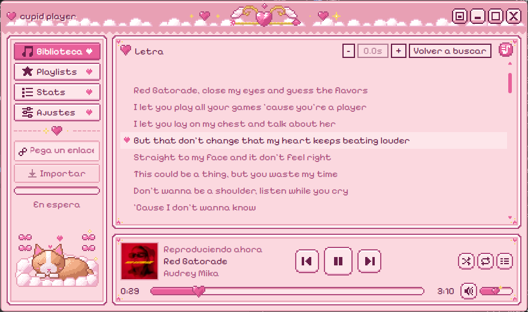
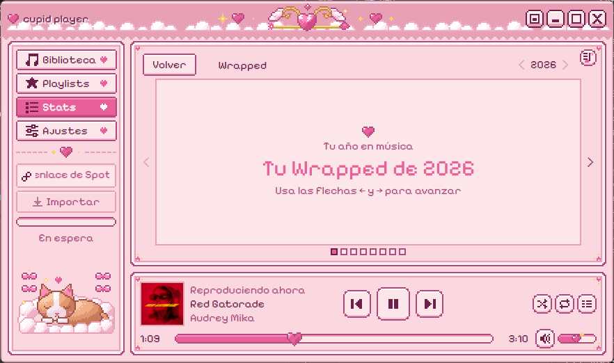
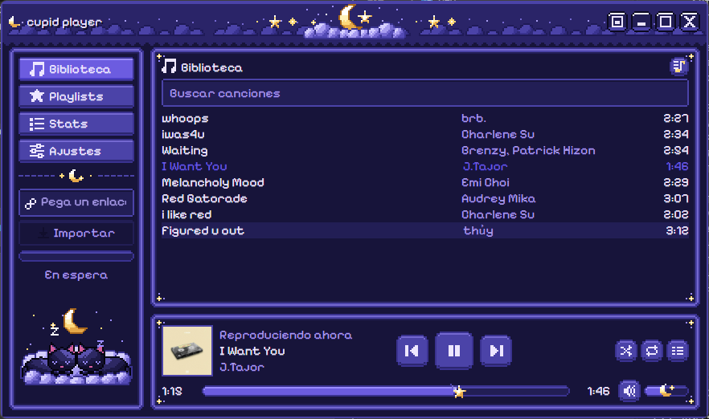
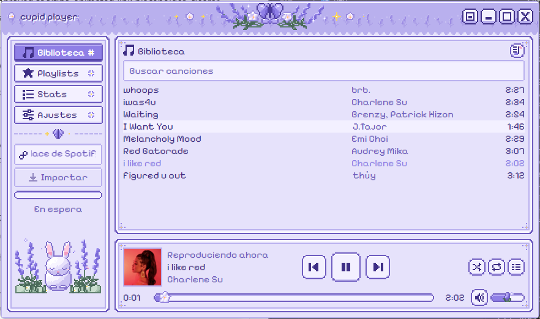
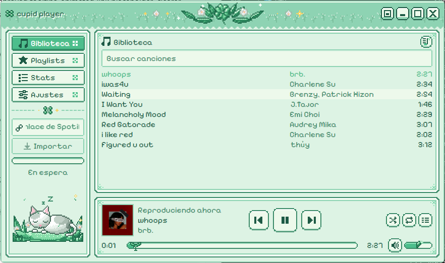
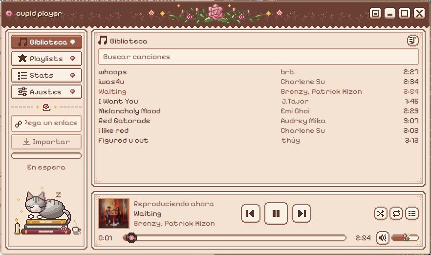

<div align="center">


# cupid player

**A tiny pixel-art music player for Windows.** Paste a public Spotify link, and the music
lands in your library, ready to play offline.

[**Download the latest release**](https://github.com/swogvex/cupid-player/releases/latest)

</div>

---

## What it does

1. You paste a public Spotify **track** or **playlist** link.
2. cupid player reads the list of songs, finds each one on YouTube with
   [yt-dlp](https://github.com/yt-dlp/yt-dlp) and downloads the audio as `.opus`, together with
   the cover art.
3. Everything is organised in a local library you can play without an internet connection.

No Spotify account, no API keys, no browser. You only see a progress bar.

## Features

- **Import** public Spotify tracks and playlists. Songs that cannot be matched confidently are
  marked and can be retried.
- **Player** with queue, shuffle, repeat (off / one / all), volume, seeking, media keys and a
  **mini mode** that fits in a corner of the screen.
- **Library** with instant search, tag and cover editing, folder import and your own playlists
  (right-click to create or edit).
- **Synced lyrics** (from [LRCLIB](https://lrclib.net)), with per-song offset and Japanese and
  Korean fonts.
- **Stats and Wrapped:** minutes really listened per month, top artist and song, and a yearly
  Wrapped.
- **Five hand-drawn pixel-art themes**, each with its own animated mascot: Lovely, Midnight,
  Lavender, Mint and Classic.
- **System tray**: close to the tray and keep listening.
- **Light on resources:** built with Tauri, about 110 MB of RAM and almost no CPU while playing.
- **Spanish and English** interface, signed automatic updates.

## Screenshots

| | |
|---|---|
|  |  |
| Synced lyrics | Yearly Wrapped |
|  |  |
| Midnight | Lavender |
|  |  |
| Mint | Classic |

## Install

**Requirements:** Windows 10 or 11 (64-bit). The WebView2 runtime comes with Windows 11 and with
up-to-date Windows 10.

1. Go to the [latest release](https://github.com/swogvex/cupid-player/releases/latest) and
   download the installer (the `-setup.exe` file, about 69 MB).
2. Run it. It installs for the current user only and **does not need administrator rights**.
3. Open **cupid player** from the Start menu.

### "Windows protected your PC" (SmartScreen)

The installer is **not code-signed**, because certificates cost money and this is a free hobby
project. Windows shows this warning for any new unsigned app. It does not mean the file is
harmful, only that Windows has not seen it many times yet.

To continue:

1. Click **More info**.
2. Click **Run anyway**.

If you want to check the download first, compare its SHA-256 with the one printed in the
summary of the release's GitHub Actions run:

```powershell
Get-FileHash .\cupid-player_*_x64-setup.exe -Algorithm SHA256
```

### Updating

cupid player checks for new versions when it starts (at most once a day) and **never installs
anything without asking you**. Updates are signed, and the app verifies the signature before
installing. You can also check by hand in **Settings → Updates**.

### Uninstalling

Use *Apps → Installed apps* in Windows. The uninstaller offers to delete the app's data. Your
music is **never** deleted.

## Using it

- Paste a Spotify link in the box at the bottom of the sidebar and press **Import**.
- Songs go to `Music\CupidPlayer\` (you can change the folder in Settings):
  `Singles\` for single tracks and `Playlists\<name>\` for playlists.
- App data (database and settings) lives in `%APPDATA%\com.swogvex.cupidplayer\`. Logs can be
  opened from **Settings → Open logs folder**.

| Shortcut | Action |
|----------|--------|
| `Space` | Play / pause |
| `←` / `→` | Seek ±5 s |
| `Ctrl` + `↑` / `↓` | Volume |
| `Esc` | Close the queue |

## Good to know

- Only **public** links work. Private playlists are out of scope.
- Spotify's public embed shows about **100 tracks per playlist**. Longer playlists are imported
  up to that limit, and the app warns you that there may be more.
- Quality is whatever YouTube offers (roughly Opus at 130–160 kbps). The audio is stored without
  re-encoding.
- Matching is automatic and not perfect: a few songs may be marked for review. Use the retry
  button on the row.
- **If downloads suddenly stop working,** YouTube probably changed something and the bundled
  yt-dlp needs updating. A new release of cupid player ships a newer version.
- Windows only for now. macOS is a possible future step.

## Build from source

You need Node.js 24, [pnpm](https://pnpm.io), the Rust stable toolchain (MSVC), the Visual Studio
Build Tools with the C++ workload, and Git.

```powershell
git clone https://github.com/swogvex/cupid-player.git
cd cupid-player
pnpm install --frozen-lockfile
pnpm sidecars:fetch      # downloads yt-dlp and ffmpeg and verifies their SHA-256
pnpm assets:build        # turns the text sprites into PNGs and theme CSS
pnpm tauri dev
```

Quality checks:

```powershell
pnpm typecheck; pnpm lint; pnpm test
cd src-tauri; cargo clippy -- -D warnings; cargo test; cd ..
```

Release installers are built by GitHub Actions when a `v*` tag is pushed (see
[`RELEASING.md`](RELEASING.md)). A local `pnpm tauri build` needs the updater signing key because
update artifacts are enabled; `pnpm tauri build --debug --no-bundle` compiles without it.

All artwork is stored as text pixel maps in `art/` and generated by scripts, so it is versioned
and reviewable like code.

## Privacy and security

- Everything runs locally. The only network traffic is: the Spotify embed page, YouTube (through
  yt-dlp), cover images, LRCLIB for lyrics, and GitHub for updates.
- The interface never touches the network or the system directly: all of that goes through the
  Rust backend, with a strict Content Security Policy and minimal permissions.
- yt-dlp and ffmpeg are pinned to exact versions and checked by SHA-256.
- Logs never contain links or listening data.

## License

cupid player is released under the [MIT License](LICENSE).

The installer also ships [yt-dlp](https://github.com/yt-dlp/yt-dlp) and
[FFmpeg](https://ffmpeg.org), both under the GPL, and three open fonts under the SIL OFL. Their
licenses and where to get their source code are listed in
[`THIRD-PARTY-NOTICES.md`](THIRD-PARTY-NOTICES.md).

cupid player is not affiliated with Spotify or YouTube.

## Support

If you like it, you can [buy me a coffee on Ko-fi](https://ko-fi.com/swogvex). Entirely optional.